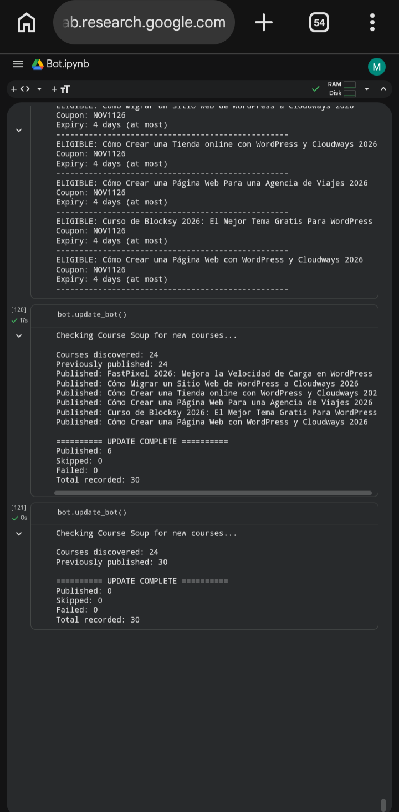

# 🎓 Udemy Free Course Discovery & Telegram Bot

An automated Python bot that discovers free Udemy course offers from Course Soup, extracts coupon information, and publishes eligible courses to a Telegram channel.

## 🚀 Project Overview

Finding free Udemy courses manually can be time-consuming.

This project automates the process by collecting course offers, extracting relevant information, checking coupon availability indicators, and publishing the results to Telegram.

## ✨ Features

- Automatically discovers Udemy course offers.
- Extracts course titles and descriptions.
- Retrieves coupon codes.
- Checks coupon activity indicators.
- Filters offers that do not meet publishing criteria.
- Publishes course information to Telegram.
- Prevents duplicate publications.
- Maintains posting history using JSON.
- Adds a delay between Telegram messages.

## 🛠️ Technologies Used

- Python
- Requests
- BeautifulSoup
- Telegram Bot API
- JSON
- Web Scraping

## ⚙️ How It Works

1. Connects to Course Soup.
2. Discovers available course pages.
3. Extracts course information and coupon codes.
4. Checks whether offers meet the publishing criteria.
5. Checks posting history to prevent duplicates.
6. Publishes eligible offers to Telegram.
7. Saves successfully published courses.
## 🏗️ System Architecture

Course Soup → Python Bot → Eligibility Checks → Telegram Channel

The bot uses:

- Course Soup as its course discovery source.
- Python and BeautifulSoup for web scraping.
- Telegram Bot API for publishing.
- Google Drive and JSON for persistent posting history.
- Google Colab for manual execution.
- GitHub for source code management.
 ## 📊 Project Results
During testing:
- 24 courses discovered in the initial run.
- 23 new courses successfully published initially.
- 6 additional courses published in a subsequent run.
- 30 courses successfully recorded in total.
- 0 failed publications.
- Duplicate prevention successfully tested.
## 📸 Project Demonstration

### Telegram Channel Publications

The bot automatically publishes eligible free Udemy course offers to Telegram.


### Bot Testing Results

The bot successfully published six new courses and passed the duplicate-prevention test.


## ⚠️ Disclaimer
Course availability and coupon validity may change.
Users should confirm that Udemy displays a zero price before enrolling.
This project is intended for educational and automation purposes.
## 👨‍💻 Author: Mayordeleke
Interested in Python, Software Development, Automation, and Web3.
## 📦 Installation

### 1. Clone the repository

```bash
git clone https://github.com/mayordeleke/udemy-course-telegram-bot.git
cd udemy-course-telegram-bot
pip install -r requirements.txt
### 2. 🔐 Environment Variables
The following environment variables are required:
TELEGRAM_BOT_TOKEN
TELEGRAM_CHAT_ID
### 3. ▶️ Running the Bot
After configuring the environment variables, run:
python main.py

